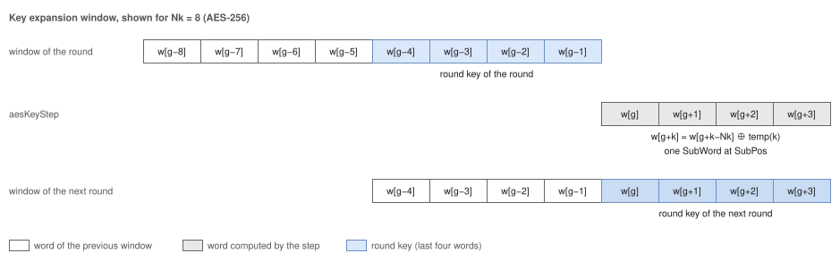

# ocr_pkg: Architecture

## 1. Contents

| Group | Declarations |
| --- | --- |
| Types | `Byte_t`, `Word_t`, `Block_t` (bits 127:120 are byte 0), `Section_t`, `Status_t` |
| Codes | `SecData_c` "00", `SecAad_c` "01", `SecTag_c` "10", `SecIv_c` "11"; `StsOk_c` 0 to `StsOverflow_c` 8 |
| Precedence | `stsPrio`, `stsMerge` |
| AES parameters | `aesNk`, `aesNr`, `aesDefaultUnits`, `aesMinUnits`, `ghashDefaultDigit` |
| AES transformations | `aesSbox`, `aesSubBytes`, `aesShiftRows`, `aesXtime`, `aesMixColumns`, `aesRound`, `aesSubWord`, `aesRotWord`, `aesRcon` |
| Key expansion | `AesKeyCtl_t`, `aesKeyCtl`, `aesKeyCtlTable`, `aesKeyStep`, `aesKeyFirst` |
| GF(2128) | `gfMulDigit`, `gfMul` |
| Byte order | `blockByte`, `blockToBeat`, `beatToBlock`, `keepOf` |

## 2. AES

The S-box is a constant table of 256 bytes (FIPS 197 Figure 7); synthesis maps it to logic or ROM. ShiftRows is a
fixed permutation of the 16 bytes, MixColumns four instances of the column multiplication with `aesXtime`.
`aesRound` composes one round; the round units of the AES engine call it once per clock cycle.

## 3. Key expansion on the fly

A window holds the last Nk words of the expansion, the oldest word in the leftmost bits; its last four words are the
round key of the next round.

`aesKeyStep` first chains the four words with XOR only. The one SubWord of the step adds a difference at position
`SubPos`; because every following word XORs its predecessor, the same difference appears in all later words of the
step. The step therefore needs one SubWord (four S-boxes) and a 4:1 multiplexer for its input. `aesKeyCtl(Nk, g)`
gives the position, the RotWord flag and the Rcon value of the step that produces w[g] to w[g + 3];
`aesKeyCtlTable` tabulates them for the rounds, so that a round unit selects the control of its round from a constant
table. `aesKeyFirst` returns the window of round 1: for Nk = 4 one step, for Nk = 6 the two words w[6] and w[7], for
Nk = 8 the key itself.

## 4. GF(2128)

`gfMulDigit` works on polynomials with the coefficient of ui at index i (the block seen with an ascending
range). It adds z · uD and the product of the D-bit digit with h, then reduces the coefficients of degree
128 to 127 + D from the top with u128 = u7 + u2 + u + 1. A product X · H with
digits of D bits is the Horner scheme over the digits of X from the highest degree (the rightmost D bits of the block)
to the lowest; `gfMul` is the case D = 128.

## 5. Byte order

Byte lane j of beat k of a stream with B bytes per beat holds byte k · B + j of a block. `blockToBeat` and
`beatToBlock` are wiring only.
